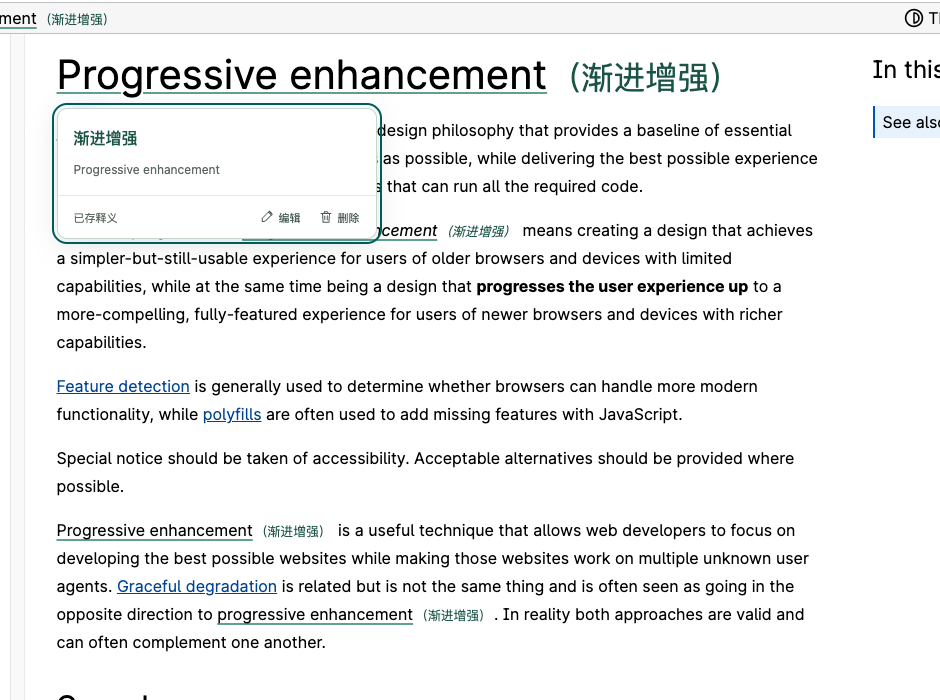
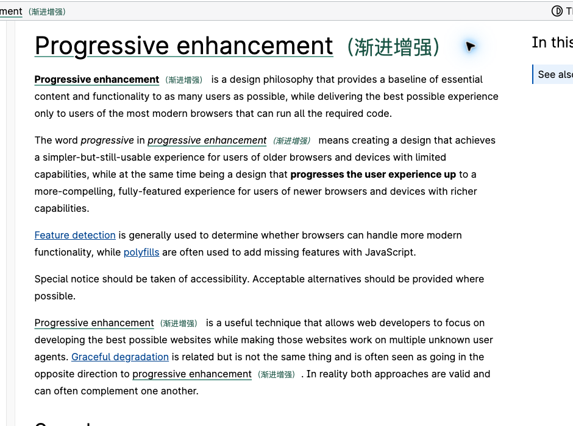
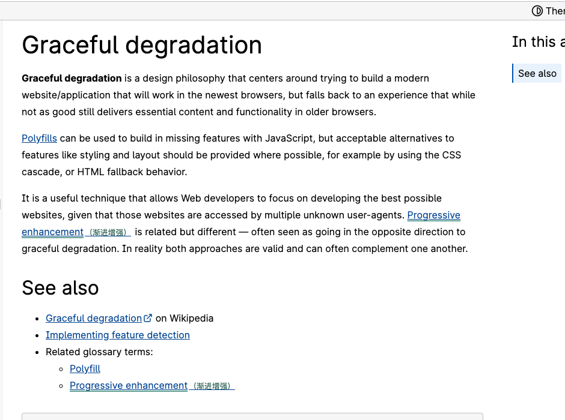

# 点译 · 翻译按需用，词句再遇见

**翻译，按需付费。再遇见，就提醒。**

用自己的模型 Key，按服务商的用量规则付费。查过的短词句留在本地，下次阅读时，释义会在原文里再次出现。

[开始使用点译](#安装) · [产品介绍页](src/intro.html) · [使用指南](docs/user-guide.html) · [阅读轨迹与回顾](docs/knowledge-guide.html) · [宣传文案与素材](docs/marketing-copy.md)



## 为什么做点译

我希望阅读外语网页时，**带上自己的模型，按实际用量付费；查过的词句，在下一篇文章里还能主动提醒我。**

于是有了点译。需要时翻译，查过就留下。换一篇文章再遇到，正文里有一条熟悉的下划线，也有之前存下的释义。

「按用量付费」指你选择的模型服务商的计费规则。点译使用你自己的 Key 直连服务，没有内置套餐、共享密钥或代扣流程。

## 把一次查词，变成下一次的眼熟

- **模型和用量，自己选。** 常用厂家配好地址与推荐型号，填入 Key 即可连接。
- **换一页，释义还在。** 已存词句在相同目标语言下跨网页复用，自动提示不再请求模型。
- **提醒，留在原文里。** 细下划线、悬浮释义或括号显示；可以编辑、删除和导出自己的词库。
- **长文章，也有读法。** 整页双语或仅译文阅读，以及独立模型的流式网页总结、长期轨迹与日周月年回顾。

## 真实阅读中的两次相遇

在 MDN 的一篇文章中，实际划选 `Progressive enhancement`，点击翻译得到「渐进增强」。打开另一篇讲 `Graceful degradation` 的文章，同一个短语已经自动带着释义出现，第二页没有再次点击翻译。

| 这一次，查懂它 | 下一页，认出它 |
| --- | --- |
|  |  |

原文来自 [MDN：Progressive enhancement](https://developer.mozilla.org/en-US/docs/Glossary/Progressive_Enhancement) 与 [MDN：Graceful degradation](https://developer.mozilla.org/en-US/docs/Glossary/Graceful_degradation)。以上是实际安装插件的浏览器截图，不是模拟界面；原文作者 Mozilla Contributors，文档内容采用 [CC BY SA 2.5](https://creativecommons.org/licenses/by-sa/2.5/)；截图经裁切并显示点译实际释义，不代表关联或背书。[素材来源与许可](src/assets/promo/MDN-SOURCES.md)。[操作与素材记录](docs/media/operations-2026-11-03.json)。

## 三步开始

1. **连接自己的模型。** 选择厂家，填写 Key，测试并保存。
2. **选一个真正想查的词。** 点击语言胶囊翻译，短词句成功后自动保存。
3. **继续阅读，在下一页再遇见。** 已存词句会在正文中提示，不必重复查询。

v0.13.0 · 2026-11-04。普通网页在后台自动保存正文和摘要，不依赖侧栏开启；相同正文及总结配置复用结果，打开侧栏直接读取本地摘要。新增「我的轨迹」「阅读回顾」、备注／项目／标签、默认每日 18:00 的可配置计划，以及日／周／月／年／专题分析和 ZIP、Markdown、HTML、JSON、JSONL、CSV 导出。总结独立使用默认及备用模型，黑名单贯穿采集、上下文、汇总与导出。[完整使用说明](docs/knowledge-guide.md)。

<details>
<summary>查看之前的版本演进</summary>

v0.10.0：网页总结已接入正式插件。工具栏弹窗最上方与网页右键提供“总结当前网页”；自动模式先识别主题，再使用相应提示词生成简体中文总结。原生侧栏只承载结果、停止／重新总结、制品预览与复制导出，翻译、词库及设置保留原入口。总结默认 `qwen-flash`，翻译仍默认 `qwen-mt-flash`，即使两者同厂家、同端点也不共用密钥。见[总结使用与边界](docs/summary-guide.md)。

v0.6.0：更名「点译」；小猫会眨眼、摆尾，点击展开功能；译文仅改文字颜色，双语比原文小 2px，仅译文保持原字号。按完整页面地址与原文结构暂存映射，刷新只恢复匹配的本地译文，不请求模型；「重新翻译」绕过旧结果、更新本页暂存。

v0.6.1：小猫缩为约 24×27px（上一版的 1/3），默认隐藏；打开工具栏插件后才显示，面板右上角可关闭。菜单、按钮与短表格标签就地追加紧凑译文，数字徽标不重复翻译；较长标签允许紧凑第二行，正文仍按段显示。[优化方案与复现](docs/compact-layout.md)。

v0.7.0：千问默认／推荐改为 `qwen-mt-flash`，保留通用型号，Key 留空并在输入框旁提供官方获取入口。增加原生 MT 协议与安全片段映射；目标中文时跳过已是中文的内容，混合段落保留中文、只追加外语片段译文，旧缓存中的重复中文也不再显示。

v0.7.1：修复实际划词、词库同步或同段真实命中变化时，重复词下划线／括号仍闪烁的问题。改为逐个实际出现位置增量对齐，未变化的标记和释义保留原节点，取消「先清空、下次空闲再重建」。[根因、方案与回归证据](docs/annotation-stability.md)。

v0.8.0：采用选定的 C 方案并收紧为约 140×34px 圆润胶囊，主按钮只显示“中文”等目标语言，不再显示“译成／并收藏”。下拉选择七种语言并记住；点击语言才翻译，切换本身不调用模型。语境收进更多，保留关闭、键盘操作及原有自动词库保存，长选区仍按段处理。

v0.9.1：修复连接错误提示丢失具体原因的问题。保留 HTTP 状态、服务错误码和请求编号，区分免费额度耗尽、模型授权、工作空间及账户状态；不回显原始响应和密钥。见[千问额度问题实测与处理](docs/qwen-access-diagnosis.md)。

v0.9.0：通用行内标签映射。原网页结构留在本地，模型只处理纯文本与片段 ID，译文返回后恢复 a、code、b／strong、font、上下标、换行等 35 种文本标签及嵌套层级。链接重新可点击，代码原样保护，保留译文颜色与双语减 2px 规则；兼容的旧缓存直接重绘，不必重译。见[可行性、实现与验证](docs/inline-structure.md)。

</details>

## 安装

无需安装 Node.js 或运行开发命令。

1. 解压 `releases/dianyi-chrome-edge-0.13.0.zip`，或直接使用已解压的 `releases/dianyi-0.13.0` 文件夹。
2. Chrome 打开 `chrome://extensions`；Edge 打开 `edge://extensions`。
3. 打开“开发者模式”，点击“加载已解压的扩展”。
4. 选择包含 `manifest.json` 的文件夹。确认名称为“点译 · 翻译与网页总结”，把“点译”固定到浏览器工具栏，方便使用。
5. 在“模型连接”中选择 DeepSeek、通义千问或 OpenAI，粘贴自己的 API Key，点击“连接并保存”。
6. 在弹窗的“总结设置”单独连接总结模型。此后符合权限和黑名单规则的网页自动保存并总结，使用所选服务额度；翻译仍使用“模型连接”。
7. 打开普通网页即可划词；也可以右键打开“点译”，总结当前网页、翻译选区或整页。无需逐站开启。

这是本地开发者安装包，尚未发布到 Chrome / Edge 商店。ZIP 需要先解压，再加载文件夹。v0.13.0 新增 `alarms` 定时和 `unlimitedStorage` 本地知识存储权限，不新增浏览历史读取权限；升级提示由浏览器处理。v0.10.0 新增 `sidePanel` 权限用于原生总结侧栏；升级后的权限提示由浏览器处理。Chrome 已进行实际安装与原生侧栏验证；Edge 使用同一 MV3 目标包，本机尚未进行原生 Edge 安装验证。

v0.2.0 将长文与短词显示分开，新增按块整页翻译、双语／仅译文、恢复原文、停止／继续与失败重试。常用厂家仍只需填写 Key。

v0.3.0 新增原生右键菜单，取消逐站开启和白名单，改用默认开启与域名黑名单；保留模型、词库与明确暂停偏好。升级需接受浏览器新增的网站权限一次。

v0.2.1 新增明确的翻译模型推荐标记、带说明的型号下拉框和“改用推荐模型”。每家默认使用适合日常翻译的轻量型号，已有自选型号保留。依据见[翻译模型推荐](docs/provider-defaults.md)。

详细说明：[HTML 阅读版](docs/user-guide.html) · [Markdown 原稿](docs/user-guide.md)。

v0.3.1 精简释义卡片：译文置顶，原文缩小置于下方，保留编辑、删除与撤销；加载和报错使用同一布局。

v0.4.0 历史版本自动合并短块请求（最多 8 块／2400 字符／60 片段），先译当前位置，再分批完成；沿用原缓存和两个并发。当时译文采用独立文字颜色、底色与侧线；v0.6.0 已去掉底色与侧线。

v0.5.0 可配置每批块数（默认 16，支持 1–64），按稳定块／片段 ID 写回。新增浅色与深色页面的译文调色板、取色器、颜色值和预览；保存颜色不重新请求模型，调整批次保留在途任务。

v0.5.1 修复动态页面同词多处出现时的下划线／括号闪烁：无关计数、时钟或状态文字更新时复用原标记，实际命中变化才重建。

## 功能

- 网页总结：自动识别、通用总结、技术总结、新闻总结、专业分析和调研分析；只分析当前页已加载的主要可见正文，包含代码与表格，不进行额外联网调研。
- 总结独立模型与提示词设置；真实 Chat Completions SSE 流式输出。符合条件的网页后台自动采集并总结，不依赖侧栏，黑名单除外。侧栏按标签页独立打开，直接读取本地结果。
- 总结支持 Markdown、代码、表格、Mermaid 与公式，支持全文及单个制品复制、导出。轨迹、快照、摘要和任务长期存于独立本地 IndexedDB，刷新、关闭来源页及重启后仍可查看；中断保留部分结果，由用户重试。
- 新增「我的轨迹」：时间、关键词、来源、项目和标签筛选，阅读备注、来源链、历史版本和安全清理。
- 新增「阅读回顾」：每日默认 18:00（可配时间／时区）、每周、每月、每年及多维专题分析。按自然日归档，晚到资料形成新版本；浏览器退出期间的缺失周期恢复后补办，同一批输入不重复请求。
- 通用知识导出：ZIP 知识包、Markdown + YAML、HTML、JSON／JSONL 和 CSV，保留证据与版本关系；完整原文需明确勾选，不包含 Key。

- 同一块内不超过 160 字符的短词句，翻译成功后自动收藏；更长或跨块选区自动按段翻译（选区最多 16000 字符）。
- 整页翻译覆盖标题、正文、导航、列表、表格和控件标签；双语时按块追加，单语时替换原文本节点，无下划线和括号。
- 小猫默认隐藏，打开工具栏点译后显示；24×27px 动画小猫点击展开功能，面板右上角可完全关闭，刷新和路由切换后隐藏。
- 菜单与按钮保留原图标、徽标与布局，译文紧跟文字；单行省略标签空间不足时，译文另起紧凑一行。
- 本页映射按完整地址、目标语言、风格、模型与原文结构暂存；刷新不自动发模型请求，支持重新翻译更新结果。
- 译文只改字色；双语字号比原文小 2px，仅译文保持原字号。
- 保留网页元素和事件，一键恢复原文；取消、失败重试、动态新增内容、设置或路由变化均有独立处理。
- 已存词句细下划线提示；鼠标悬浮、点击和键盘均可查看释义。
- 悬浮／括号两种释义模式，跨网页复用本地词库，不重复请求模型。
- 悬浮删除、同步移除对应标记，8 秒内可撤销；词库搜索、筛选、分页、编辑、批量删除与导出。
- 内置 DeepSeek、通义千问、OpenAI 预设，常用厂家只需填写 Key；自定义 Chat Completions 服务和无鉴权本地模型仍可配置。
- 目标语言默认简体中文，支持 English、日本語、한국어、Français、Deutsch、Español。
- 常规／专业／幽默风格和可编辑自定义提示词；语境发送可选，默认关闭。
- 普通 HTTP(S) 网页默认开启，黑名单按域名及子域名停用；浮窗与右键均可一步暂停／恢复。
- 原生右键菜单：总结当前网页、翻译选中文字、翻译整页、恢复原文、网站启停和模型设置。
- 密钥默认放在本次浏览器会话，长期保存需明确勾选；网页脚本无法读取配置或凭据。

## 默认模型与备用 Key

在「模型连接」或「总结设置」点击「新增连接」。每种用途最多保存 8 个连接，可以是同厂家不同 Key，也可以是不同模型。选一个作为默认，勾选其余连接的「备用」，用上下按钮调整备用顺序。每个连接的会话或长期保存选项各自独立，新连接不会借用其他 Key；原有配置会保留为默认连接。

默认连接出现网络、鉴权、额度或服务故障时，按顺序尝试备用，每个最多一次。取消或结果格式异常时不切换；总结已输出文字后保留结果，不自动重跑。全部连接失败会暂停整页队列，避免在每一块上重复失败调用。备用服务可能处理相同资料，并按各自规则使用额度。

## 本机 Codex 登录

在两种模型设置中选择「本机 Codex」，按[连接指引](docs/codex-setup.html)安装随包提供的本机助手，再检测登录、选择可用型号并保存。浏览器不导入 auth.json 或保存 OAuth 令牌；API Key 连接和 Codex 连接可以互为备用。

已用本机现有 ChatGPT 登录、通过官方 app-server 完成真实短词翻译和增量输出。本机助手当前支持 macOS / Linux，需 Python 3.10+ 及 Codex CLI。Codex 继续使用其账户权限、额度和服务配置；ChatGPT 登录的套餐用量与普通 API Key 按量计费不同，不承诺免费或无限使用。auto 沿用本机默认型号，可改选账户可用的轻量型号。[实测范围](verification/codex-live-0.12.0.json)。

## 模型配置

翻译配置在原“模型连接”（`options.html#model`），总结配置在“总结设置”（`options.html#summary`）。总结设置包含厂家、独立 Key、推荐／自定义模型、默认场景及各场景提示词；保存偏好不重跑已有结果。两套密钥均默认只保留本次浏览器会话，长期保存分别明确勾选。总结使用支持流式输出的通用对话模型，拒绝 `qwen-mt-*` 翻译专用型号。

常用厂家选择后自动填写官方地址和推荐模型，只需 API Key。高级设置可调整模型、请求超时；千问默认北京地域，可切换新加坡。切换厂家或地域时清空尚未保存的 Key，避免混用。旧版自定义连接、词库和密钥归属保持不变。


服务地址可以是基础地址，也可以是完整的 `/chat/completions` 地址。翻译按现有协议发送 `model`、`messages`、`stream: false` 并解析 `choices[0].message.content`；千问 MT 使用专用适配。总结生成使用 `stream: true` 的 Chat Completions SSE，自动分类另有一次非流式请求。

没有内置共享密钥、免费模型或演示词典。服务需支持 Chat Completions；厂商专有协议需要另行适配。远端地址必须为 HTTPS，本机回环地址可使用 HTTP。正式版没有中转服务器，译文来自用户配置的服务。

## 产品介绍页预览

管理界面左侧点击「产品介绍」。也可以在项目目录运行 `python3 scripts/serve-intro.py`，打开 `http://127.0.0.1:8428/`；独立预览提供安装步骤和安装包下载。宣传文案提供 [HTML 阅读版](docs/marketing-copy.html) 与 [Markdown 原稿](docs/marketing-copy.md)。

## 开发与验证

总结渲染器包含本地随包分发的第三方运行时：markdown-it 15.0.3、Mermaid 12.2.0、KaTeX 0.19.1；不加载 CDN 脚本或远程字体。开发需要 Node.js 20+，使用锁定依赖与 esbuild 0.28.2 可复现构建。

```sh
npm ci
npm run build:renderers
npm run check
npm test
npm run build
```

安装目录与 ZIP 输出到 `releases/`。完整浏览器测试另外需要 Python Playwright 与支持侧载扩展的 Chromium / Chrome for Testing：

```sh
npm run test:e2e
npm run test:long
npm run test:page
node scripts/e2e.mjs tests/reader_throughput_e2e.py
node scripts/e2e.mjs tests/reading_preferences_e2e.py
node scripts/e2e.mjs tests/repeated_word_e2e.py
node scripts/e2e.mjs tests/page_memory_e2e.py
node scripts/e2e.mjs tests/compact_layout_e2e.py
node scripts/e2e.mjs tests/mt_chinese_e2e.py
node scripts/e2e.mjs tests/knowledge_e2e.py
node scripts/e2e.mjs tests/knowledge_native_e2e.py
```

可用 `SHIYI_TEST_PYTHON` 指定 Python，`SHIYI_TEST_CHROMIUM` 指定浏览器二进制。测试在独立临时用户配置中运行，不修改日常浏览器或安装扩展。

v0.13.0：151 项单元检查、40 个生产脚本静态检查、15 项后台阅读知识完整流程及 11 项原生 Chrome 侧栏场景通过。包括完整浏览器重启、实际 Chrome 闹钟触发、五种回顾、备注草稿、制品和六种文件下载。使用最终 ZIP、临时浏览器资料与真实本地 HTTP/SSE，不使用付费账户。见[当前验收记录](docs/verification.md)与 `verification/knowledge-0.13.0.json`、`knowledge-native-0.13.0.json`、`knowledge-release-0.13.0.json`。

v0.12.1 的 126 项单元检查、34 个生产脚本静态检查、19 项总结与制品回归、11 项原生 Chrome 侧栏场景通过。原生侧栏使用未修改 ZIP、临时浏览器资料与本地 HTTP/SSE，覆盖直接打开自动总结、标签页隔离、刷新／导航、同页复用、关闭及黑名单；没有使用真实付费模型或读取现有浏览器凭据。记录见 `verification/summary-panel-0.12.1.json`、`summary-0.12.1.json` 和 `summary-panel-release-0.12.1.json`。

介绍页和管理入口历史验收见 `verification/intro-0.12.0.json`，安装包字节一致性与历史包保护记录见 `verification/connections-release-0.12.0.json`。v0.12.0 的 114 项单元检查、6 项本机助手检查、33 个生产脚本静态检查、桌面与小屏交互检查均通过；管理入口采用空配置的隔离 HTTP 界面验收，未访问真实扩展设置或凭据。

小猫截图见 `verification/dianyi-pet-menu.png`，文本排版见 `verification/dianyi-text-only-reading.png`；卡片实际截图见 `verification/tooltip-card.png`。`verification/package.json` 保留 v0.10.0 的历史安装包验收。

总结专项见 `verification/summary-0.10.0.json`（19 项，未修改 ZIP 与真实本地 HTTP/SSE）；原生侧栏截图见 `verification/summary-native-open.png`，窄宽度与制品见 `verification/summary-320.png`、`summary-390.png`、`summary-600.png`、`summary-artifacts.png`。这些记录不代表已使用真实付费厂家账户验证。

v0.10.0 的翻译回归、102 项单元与 19 项总结专项记录保留原版本，不计作 v0.12.0 的新回执。历史检查结果见 `verification/extension-e2e.json`、`verification/inline-structure-0.9.1.json`、`verification/selection-capsule-e2e.json`、`verification/native-context-menu.json`、`verification/page-translation-e2e.json` 、`verification/page-memory-e2e.json` 和 `verification/long-text-0.9.1.json`，验证边界见 [验收说明](docs/verification.md)，方案与定位见 [长文方案](docs/block-reading.md)。

## 文件结构

| 路径 | 用途 |
| --- | --- |
| src/manifest.json | Manifest V3 与按需来源权限 |
| src/background.js | 可信消息入口、网站启停、模型调用编排、同步 |
| src/lib/ | 配置校验、词库、缓存、模型适配与词句匹配 |
| src/content/ | 网页选区、可恢复注解、独立释义浮层 |
| src/ui/ | 工具栏浮窗、原生总结侧栏、词库、设置与使用指南 |
| src/lib/summary-*.js | 总结场景、正文提取、独立流式请求与会话结果管理 |
| src/vendor/ | 本地总结渲染器及第三方许可 |
| scripts/ | 渲染器构建、打包和检查 |
| tests/ | 单元测试与真实加载扩展的浏览器验证 |
| docs/ | 安装使用、实现说明与验收材料 |
| releases/ | 可安装文件夹与 ZIP |

## 当前边界

总结纳入已加载主要可见正文的前 60,000 字符以内内容，截取时明确提示；不读取表单值、编辑区、隐藏区、导航或侧边栏。仅译文状态仍提取原文。自动模式正常为 2 次请求，手动场景为 1 次；主动重新总结会再次使用额度。单任务最长 3 分钟、输出最多 8 万字符；配置中的无响应超时是连续收不到响应的秒数。详情见[总结说明](docs/summary-guide.md)。浏览器原生分隔线承担宽度调整，高度随窗口；宽度上下界由浏览器决定。物理拖动尚未完成自动化验收。

翻译处理普通网页主文档可读文字。浏览器内部页、扩展商店、内置 PDF、图片／Canvas 文字、iframe 与 Shadow DOM 组件暂不支持；代码与编辑内容跳过。整页初次最多处理 400 块或约 12 万字符，可继续；新增内容需主动翻译。页面暂存约 7 天，最多 50 页、合计约 20 MiB、单页约 3 MiB，容量不足时淘汰较旧映射，可在「本地数据」清除。动态新增或变更的块保留原文，需主动翻译。词库不做云同步，提供导出，暂不提供导入或自动多义项判断。模型、语言和风格变更不覆盖已保存释义。

卸载前请先导出词库。升级时保留原安装文件夹路径，将新版文件覆盖后在扩展管理页重新加载，避免卸载导致数据丢失。

## 阅读资料留下来

v0.13.0 已按完整范围交付。安装升级后，从当前可读取标签页和后续访问开始，不扫描浏览器已有历史。自动页面总结及周期回顾会使用独立总结模型额度；本地资料没有云端备份，请定期导出。

[使用指南（HTML）](docs/knowledge-guide.html) · [使用指南（Markdown）](docs/knowledge-guide.md) · [原需求与决策记录](docs/reading-trails-plan.md)
